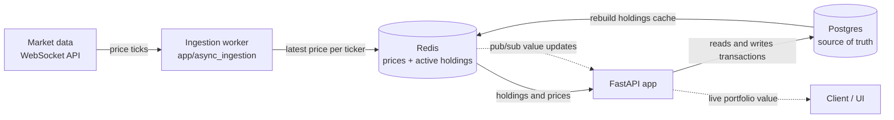
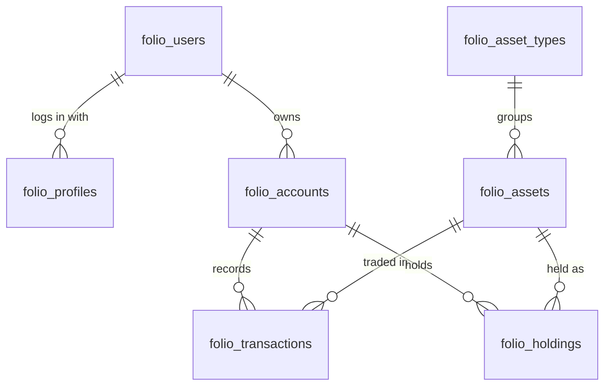

# Port Folio

A real-time portfolio calculator. It records every transaction you make, whether that's buying ETFs, commodities or putting money into savings, and shows the live value of your holdings as market prices change.

## Architecture

Prices stream in over a WebSocket, live state is kept in Redis, and Postgres is the permanent record. A FastAPI app sits in the middle and serves both the API and live updates to the UI.

### Components

| Component | Role |
|---|---|
| WebSocket price feed | External market data API that pushes real-time price ticks for the tickers we subscribe to. |
| Ingestion worker | Async consumer that keeps the socket connected, reconnects with backoff on failure, and writes each tick to Redis. |
| Redis | Fast, in-memory state: the latest price per ticker and a cache of every active holding (quantity and cost basis). Also carries pub/sub messages for live updates. |
| FastAPI app | REST API for users, profiles, accounts, assets, transactions and holdings, plus a WebSocket endpoint that pushes the live portfolio value to clients. |
| Postgres | The permanent record. Every transaction is stored here, along with each account's current holdings, which are calculated from those transactions. |

### How data flows

There are two paths through the system.

**Recording a transaction.** The client calls the FastAPI app, which writes the transaction to Postgres. The app then recalculates that holding's quantity and average price, saves it to Postgres, and updates the cached copy in Redis.

**Live valuation.** The ingestion worker writes each new price to Redis. Holdings that use that ticker are revalued, and the new portfolio value is published over Redis pub/sub. The FastAPI app forwards it to connected clients over a WebSocket.

### Why Redis and Postgres both exist

Redis holds data that must be read on every price tick, so it has to be fast. Postgres holds data that must never be lost. Redis can be cleared at any time and rebuilt from Postgres, because Postgres stores every holding and the transactions it came from.

## Data model

All tables use the `folio_` prefix. Models live in `app/db/models/` and are defined with SQLAlchemy 2.

| Table | Purpose |
|---|---|
| `folio_users` | A person using the app: name, birth date, avatar and email. |
| `folio_profiles` | A way for a user to log in, such as a username and password or a Google account. A user can have several, one for each way they log in. Profiles hold no financial data. |
| `folio_accounts` | A named bucket of a user's money, such as a brokerage account or a retirement account. A user can have many accounts. |
| `folio_asset_types` | Reference list of asset categories, such as ETF, Stock, Commodity, Bond or Cash. |
| `folio_assets` | Individual instruments, such as an ETF on a given exchange or a fixed deposit. Ticker and exchange are optional. Each asset also stores its last known market price and when that price was quoted. |
| `folio_transactions` | Each buy or sell of an asset within an account: quantity, price, commission and timestamp. The total price is calculated by Postgres. |
| `folio_holdings` | The current position in one asset within one account, after all of its transactions: quantity, average price, and the times of the first and last transaction. |

Money and quantities use exact decimal types throughout, never floating point. Prices and quantities are stored with up to 8 decimal places.

## Tech stack

- **Python 3.14** with **FastAPI** and **Uvicorn**
- **PostgreSQL** with **SQLAlchemy 2** (async) and **asyncpg**
- **Alembic** for database migrations
- **Redis** for caching and pub/sub
- **aiohttp** for the WebSocket price feed client

## Project status

| Part | Status |
|---|---|
| Database models | Users, profiles, accounts, asset types, assets with market prices, transactions and holdings are done, with tests. |
| Database migrations | Not set up yet. |
| Holding recalculation | Not started. Nothing updates a holding when a transaction is saved yet. |
| Price ingestion worker | Not started. |
| Redis caching and pub/sub | Not started. |
| FastAPI endpoints | Not started. |